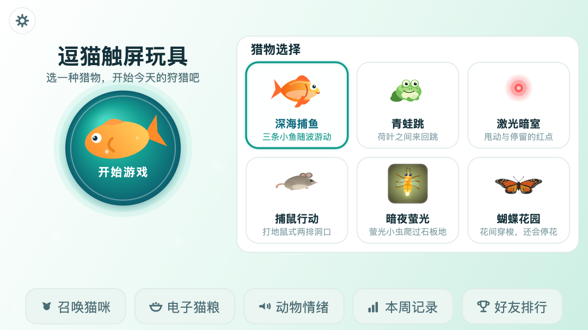

# 逗猫猎场 · 产品需求文档（PRD）

> 版本 V1.0 ｜ 2026-11-15 ｜ 微信小游戏 `minigame/` 当前实现

## 一、产品概述

**定位**：给家猫玩的触屏狩猎玩具。手机横屏平放，屏幕里跑动鱼、蝴蝶、老鼠等猎物，猫拍打屏幕完成捕猎，主人负责选玩法、开局与复盘。

**双角色**

| 角色 | 诉求 | 产品应对 |
|---|---|---|
| 猫（玩家） | 目标醒目、动作有规律、扑击有反馈 | 高对比配色、发光轮廓、命中粒子与音效、自适应降速 |
| 主人（决策者） | 省事、能复盘、可分享 | 一键开局、自动保存设置、结算评级、分享卡与周记录 |

**核心循环**：选玩法 →（多背景玩法先选背景）→ 3 秒倒计时 → 猫拍猎物得分 → 结算评级 → 周记录/好友排行/分享卡 → 再来一局。

## 二、玩法体系

| 玩法 | key | 猎物 | 核心动作 | 可多只 |
|---|---|---|---|---|
| 深海捕鱼 | fish | 10 种鱼 | 鱼群巡游，拍中即捕获 | 是（3→5→7） |
| 蝴蝶花园 | butterfly | 蝴蝶（6 花色） | 飞行 → 降落花朵停留 | 是 |
| 捕鼠行动 | mouse | 老鼠 | 两排洞口探头／窜洞 | 是（按洞口封顶） |
| 激光暗室 | laser | 赤红光点 | 高速掠过 ↔ 原地停留 | 是（3→5） |
| 暗夜萤光 | pool | 萤光小虫 | 石板地爬行，拍中即灭 | 否（固定 1 只） |
| 青蛙跳 | frog | 青蛙 | 荷叶间跳跃，腾空 +2 | 是（按荷叶封顶） |

### 深海捕鱼
三阶段：①0–20s 横向直线巡游；②20–70s 加大纵向摆动；③70s 后全向追踪航点（水草海域 1/3 航点在屏外）。
品种速度：乌龟 0.5、河豚 0.55、鲸鱼 0.65、金鱼 0.7、神仙鱼 0.75、锦鲤 0.85、小丑鱼 1.0、鲨鱼 1.2、沙丁鱼 1.45。
三海域：水草森林（默认，会出屏）／泳池追鱼（全程不出屏）／鱼群巡游（结群，单只 3→4→5、多只 6→9→12）。

### 蝴蝶花园
七态状态机（FLAP→GLIDE→LANDING→停留→TAKEOFF→STARTLED）；停留为最佳命中窗口；命中盒 ×1.7；从上/左/右飞入。

### 捕鼠行动
两排 10 个洞口，peek→dart→缩回；连续被拍会受惊加速。
室内房间只保留两种鼠叫（出洞循环 + 命中），拍偏音、成就音、倒计时音一律不播。

### 激光暗室
dart 高速掠过 ↔ hold 原地停留；dart 途中概率瞬移并有闪烁预警；多只 3→5→7，落点互相避开 ≥150px。
当前只有「赤红光点」一种配色。

### 暗夜萤光
深色石板地 + 萤尘；整局固定 1 只萤光小虫；慢爬/急爬两档交替、撞边反弹、头朝行进方向；9–13s 自发换位；尾灯约 2Hz 呼吸；拍中 0.08s 收光、0.12–0.55s 后别处亮起。

### 青蛙跳
四态：蓄力 0.55s（末 0.35s 目标叶亮金圈，+1）／腾空 0.75s（**+2 空中截击**）／落水 0.28s（+1）／静坐 0.90s（+1）。
四阶段（1 分钟局）：①0–18s 慢跳／②18–33s 快跳／③33–48s 连跳／④48–60s 换场（20 片左右荷叶，3 片小叶踩即沉没，周边 2 片叶内任选落点）。
判定 ×1.15（落水 ×1.25），腾空时光晕放大 1.35 倍兼作提示。

## 三、通用机制

- **时长**：1 分钟 / 3 分钟（默认）/ 5 分钟 / 无限。
- **阶段**：普通玩法 20s + 50s 分三段；青蛙四段。
- **难度**：悠闲 0.65×速度 / 1.3×体型；标准 1.0 / 1.0（蝴蝶、老鼠额外 ×1.2）；激烈 1.5 / 0.85（额外 ×1.25）。
- **数量**：单只 = 1；多只开局 3，随阶段 3→5→7（捕鼠按洞口封顶、青蛙按荷叶封顶）。
- **宽容连击**：拍中 +1 且失误−2；拍附近没中连击减半；拍空不清零只加失误。
- **连击提速**：≥5 ×1.12；≥10 ×1.25/×0.92；≥15 ×1.45/×0.85（失误 ≥3 回落）。
- **自适应辅助**：missStreak ≥3/≥6/≥9 三级降档，速度最低 ×0.6、体型最大 ×1.55，连击 ≥3 关闭。
- **暂停**：右上按钮长按 600ms。

## 四、系统功能

- **首页**：左侧品牌与开始入口，右侧六玩法卡片（3×2），底部五个功能入口，左上齿轮进设置。
- **设置**（抽屉，自动保存）：猎物数量 / 难度 / 时长 / 音效 / 震动 / 自适应辅助 / 屏幕常亮 / 意见反馈 / 分享 / 防误触。
- **结算**：评级（hpm ≥18 捕猎大师；≥9 或互动且 ≥6 矫健猎手；≥3.5 或互动 灵巧学徒；否则 慵懒观察员）+ 触碰次数/总捕获/命中率/最高连击 + 再来一局/晒给猫友/存成图片/返回首页。
- **本周记录**：最近 7 天、最多 200 条，横屏双列、可拖动滚动。
- **好友排行**：需 WxFriendInteraction 授权，四种状态文案，拒绝后引导去设置。
- **分享卡**：量词随玩法；零命中改写为「全程当观众」。
- **召唤猫咪 / 电子猫粮 / 动物情绪**：三个陪伴模块。

## 五、界面规格

- 强制横屏；UI 在 390×844 虚拟空间布局后按 S = √(W×H/(390×844))（封顶 2.0）整体放大。
- 四边安全区内缩；横屏避让微信胶囊。
- 对局 HUD：左上倒计时与得分、右上长按暂停、底部适龄与健康提示。

## 六、异常与兼容

配置白名单回落、记录坏数据兜底、音频两级回退、好友权限降级、小屏自适应、主包 ≤4MB。

## 七、数据埋点

app_open / mode_pick / game_start / game_end / save_card / share_tap / invite_tap / lb_open / lb_auth / sound_play / feeder_open / feeder_feed / feeder_eat。
放弃率 = 1 − done1/game_start；hpm = hits / 分钟。

## 八、迭代记录

| 时间 | 变更 |
|---|---|
| 2026-10-24 | 六玩法成型、规则文档建立 |
| 2026-11-04～06 | 暗夜萤光按参考视频重做 |
| 2026-11-08 | 声音页头像改版、萤光恢复并放缓、猎物默认单只、结算加设置、青蛙四阶段、荷叶加密、鱼群两档、老鼠真实叫声与室内静音 |
| 2026-11-09 | 蝴蝶夜间昆虫模式移除 |
| 2026-11-14 | 激光收敛为纯红；首页 3D 素材版评估后回滚 |
